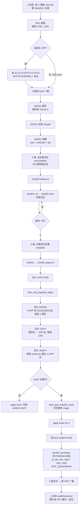

# 03 · S 蓝牙板自升级流程（目标 = S）

## 一句话

**上位机把新 S APP 镜像通过 BLE 发到 S 板的暂存区，校验通过后 S 板自己把暂存区搬到 APP 区，然后复位进新 APP。全程主控不参与。**

## 流程图



## 与 M 路径的本质区别

| | 目标 S | 目标 M |
|---|---|---|
| 暂存区之后 | **搬运到自己的 APP 区** | **UART 转发给主控** |
| 0x10xx UART 帧 | 完全没有 | 0x1000/1001/1002/1011/1012/1021/FF00 |
| 主控 | 不参与 | 全程参与 |
| 谁复位 | **S 板自己复位** | S 板**不复位**，主控跳 APP |
| 上位机是否要重连 | **要** | **不要** |
| 完成后广播 | 由新 APP 提供 | 由仍在运行的 boot 继续提供 |

## S 侧三个切片阶段（实测日志）

```
[BL] apply tgt=1 base=0x01030000 len=68336
[BL] sub slice start len=68336
[SUB] erase  0/68336  → 65536/68336
[SUB] copy   0/68336  → 16384 → 32768 → 49152 → 65536
[SUB] verify 0/68336  → 16384 → 32768 → 49152 → 65536
[BL] sub mark ok
[BL] apply err=0
[BL] apply done ok=1
[5] 完成应答 0x00
```

**为什么必须切片**：一次擦/拷整片会阻塞 BLE 协议栈数秒，连接直接断。每拍做一小片，中间让 `rwip_schedule()` 跑。

## 复位判据（踩过的坑）

```c
// 反例：只在 target==SUB 时复位，但 reset_session() 先把 target 清了
//       → 判断永远不成立 → 升级成功却不复位

// 正确：在 reset_pending 置位那一刻把目标存进独立静态变量
s_dispatch_target = ctx.upgrade_target;
// main.c 用 getter 读它
if (boot_ble_upgrade_get_dispatch_target() == BOOT_FLASH_TARGET_SUB) break;
```

## APPLYING 期间不消费 BLE 帧（结构性）

`boot_ble_upgrade_process()` 在 `state == APPLYING` 时**提前 return**，位置在 `take_received_frame()` 之前。所以上位机发的 `0x0501` 在应用阶段连读都没读。

上位机必须**重发 `0x0501`**（插件每 2 s、30 次；网页 30 次 / 1.5 s），等设备 apply 结束回到 BEACON 才被处理。

## 0x0502 的语义

`0x0502` 是**应用结果**，不是「收到」。

```c
// handle_terminate()
ctx.apply_ok ? STATUS_OK(0x00) : 错误码
```

| 值 | 含义 |
|---|---|
| `0x00` | apply 成功 |
| `0xFF` | apply 超时 / 失败 |
| 无应答 | 设备不在 BEACON，或还在 APPLYING |

## 电源（S 侧）

| 阶段 | 引脚 |
|---|---|
| S boot `power_gpio_init()` | `PB1` POWER + `PB12` EN2，都 `GPIO_SetBits` 拉高 |
| S APP `Power_Gpio_Init()` | `PB1` 同样拉高（**原 POWER_OFF 会断电变砖**，已修） |

`NVIC_SystemReset()` 不复位射频核，所以自升级复位前要 `ns_ble_adv_stop()` + `rwip_reset()`，否则新 APP 接手的是脏 BLE 栈、不广播。

## 成功判据

```
[BL] apply tgt=1
[SUB] erase → copy → verify 三段全走完
[BL] sub mark ok / apply done ok=1
[5] 完成应答 0x00
设备断开 → 重新广播 → 探针识别为 APP
总耗时 10~12 s（数据 5~6 s）
```
